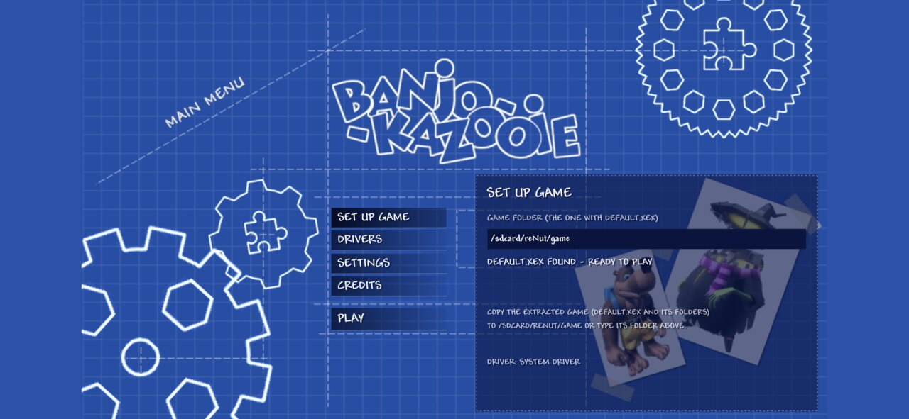
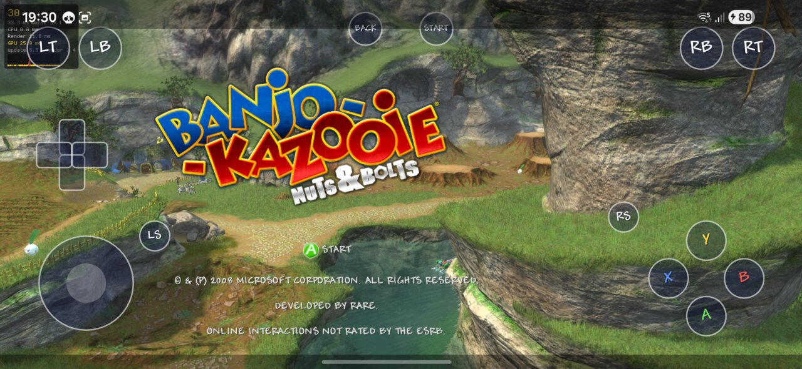
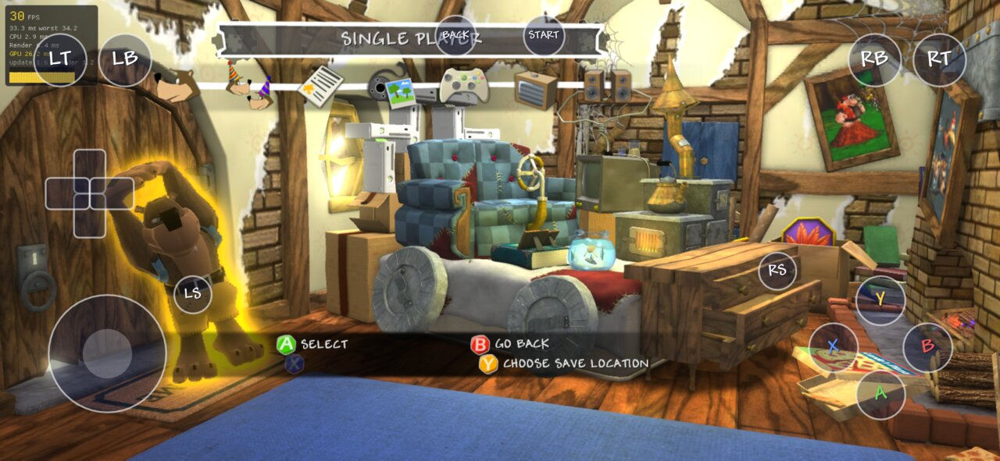
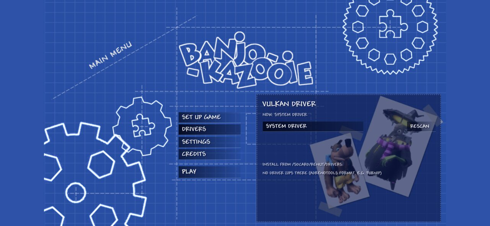

# reNut for Android

An Android port of [reNut](https://github.com/masterspike52/reNut), the Banjo-Kazooie: Nuts & Bolts recompilation built with the [ReXGlue SDK](https://github.com/rexglue/rexglue-sdk). It runs natively on arm64 with Vulkan. It also contains a Nintendo Switch homebrew port.

Tested on a Galaxy S25+ (Snapdragon 8 Elite, Adreno 830, Android 16).

<p>
 
 
</p>

## Features

- Manager screen before the game, in NutStaller's style:
  - Set Up Game: pick the game folder, or extract a disc image (built-in extract-xiso).
  - Drivers: pick a custom Vulkan driver (Turnip and others, through libadrenotools).
  - Settings: reNut's options, with defaults sized for phones.
- On-screen controls (virtual Xbox pad) with an editable layout. They hide while a gamepad is connected.
- Back gesture opens a side menu: resume, settings, touch layout, exit to the manager. The game pauses while it is open.
- Backgrounding the app pauses the game.
- Compiled shaders are kept on disk (one cache per driver). A small overlay shows while shaders compile.

## Install and play

1. Install `reNut.apk` from the [releases](../../releases/latest) page. Allow "all files access" when asked.
2. You need your own copy of Banjo-Kazooie: Nuts & Bolts (USA). Copy the disc image (`.iso`) to `/sdcard/reNut/` or `/sdcard/Download/`, then use Extract on the Set Up Game page. You can also copy an already extracted game to `/sdcard/reNut/game`.
3. Press Play.

Custom drivers: put AdrenoTools driver zips in `/sdcard/reNut/drivers`, then install them from the Drivers page. If a driver crashes the game, the next start falls back to the system driver.

Config, logs and caches live in `/sdcard/Android/data/com.rexglue.renut/files`.

## Building

You need the Android SDK and NDK 29, and a host (x86-64 Linux) build of the rexglue CLI for codegen. Clone the SDK fork next to this repo:

```
git clone --recursive -b renut-android https://github.com/etonedemid/rexglue-sdk
git clone --recursive https://github.com/etonedemid/reNut-android reNut
cd reNut
# put your default.xex and the game files in assets/ (codegen and shader dump read them)
android/configure.sh
android/build.sh install
```

The Switch build has two local patches that are not pushed: an FFmpeg `config.h` entry and volk's static NVK entry point.

## Credits

reNut by masterspike52 and contributors. ReXGlue SDK by the ReXGlue team. libadrenotools by bylaws. The NutStaller art and the Andy font come from NutStaller. Android and Switch ports by etonedemid. Discord: https://discord.gg/D5Bz2ZsHdY
